# LOGISYNC SCM - GUÍA TÉCNICA DE PATRONES DE DISEÑO GOF
## Patrones Creacionales y Estructurales Implementados en el Backend

Este documento sirve como guía completa para sustentar y documentar en el archivo principal `Sistema de Gestion de Cadenas de Suministro.docx` cada uno de los patrones de diseño Creacionales y Estructurales implementados en el backend de LogiSync.

---

# I. PATRONES CREACIONALES

---

## 1. Patrón Singleton (Instancia Única)

### A. Colaboración en el Proyecto y Problema Resuelto
- **Problema Resuelto:** La creación descontrolada de instancias de servicios pesados o de descriptores inmutables repetitivos consume memoria innecesaria y puede provocar inconsistencias de estado si diferentes partes del sistema manejan copias separadas.
- **Colaboración:**
  1. **A nivel de Framework (Spring IoC):** Los servicios principales del sistema (`InventoryMovementService`, `PurchaseOrderService`, `OrderService`, `DefaultSupplyChainMediator`) están configurados como **Singletons** mediante `@Service` y `@Component`, existiendo una única instancia en el contenedor de inversión de control que se inyecta en los controladores y fachadas.
  2. **A nivel de Dominio Puro:** En `MovementTypeFactory`, se implementa una caché estática en memoria concurrente (`ConcurrentHashMap`) con constructor privado que garantiza que para cada código de movimiento (`ENTRADA`, `SALIDA`, `AJUSTE`, `TRASLADO`), exista una única referencia en memoria compartida por todos los hilos de ejecución.

### B. Diagrama de Clases UML
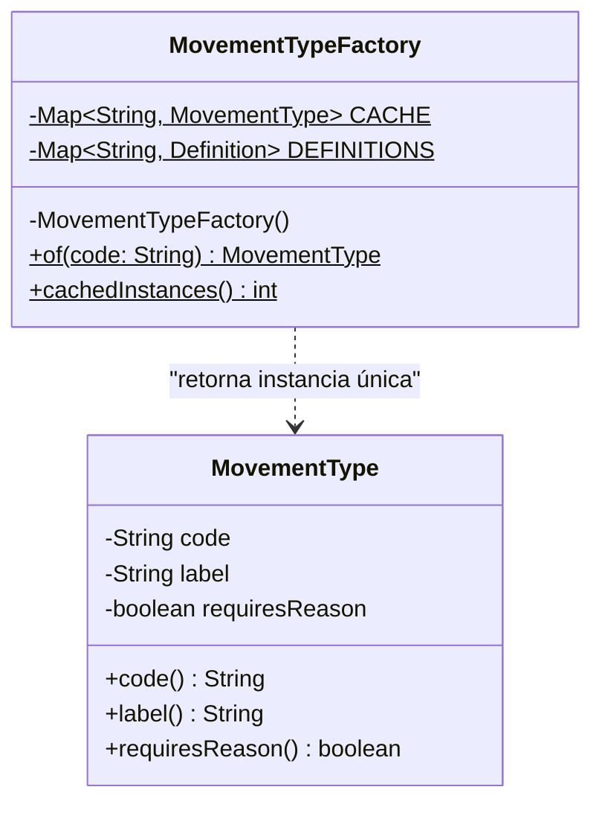

### C. Partes del Código donde está Aplicado
- `backend/sistema_cadena_suministro/src/main/java/com/logisync/sistema_cadena_suministro/domain/inventory/MovementTypeFactory.java`
- Servicios y componentes de la capa de aplicación con alcance Singleton por defecto en Spring Boot.

### D. Responsabilidad de Cada Clase
- **`MovementTypeFactory`:** Controla de manera estricta el ciclo de vida e inicialización perezosa de los tipos de movimiento, evitando constructores públicos.
- **`MovementType`:** Objeto inmutable del cual existe una sola instancia por cada código de operación en el almacén.

### E. Cómo Probarlo y Verificar su Funcionamiento
- **Prueba Unitaria:** `src/test/java/com/logisync/sistema_cadena_suministro/domain/inventory/MovementTypeFactoryTest.java`
  - Método: `returnsTheSameSharedInstancePerCode()`
  - Verificación: `assertSame(MovementTypeFactory.of("ENTRADA"), MovementTypeFactory.of(" entrada "));` comprueba igualdad de referencia en memoria (`==`).

---

## 2. Patrón Factory Method (Método de Fábrica)

### A. Colaboración en el Proyecto y Problema Resuelto
- **Problema Resuelto:** Evitar que los controladores, mappers o entidades contengan bifurcaciones (`switch` / `if-else`) repetitivas para decidir qué clase concreta de estado instanciar cuando una orden cambia de fase o cuando se reconstruye desde la base de datos.
- **Colaboración:** Proporciona un método centralizado (`from(...)`) que delega la instanciación de las clases polimórficas del patrón State. Se utiliza en `PurchaseOrderStateFactory` y `OrderStateFactory`.

### B. Diagrama de Clases UML
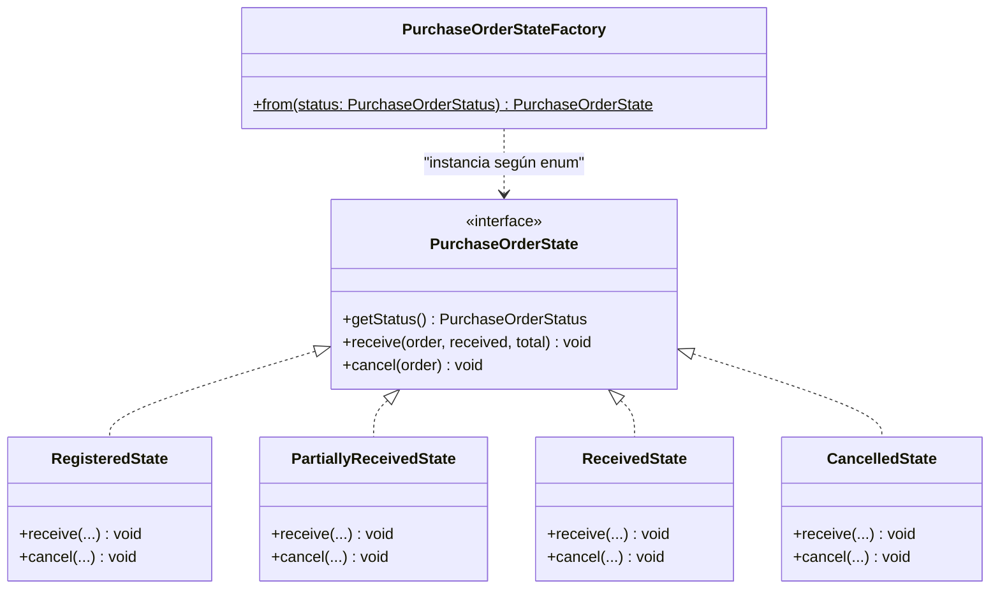

### C. Partes del Código donde está Aplicado
- `backend/sistema_cadena_suministro/src/main/java/com/logisync/sistema_cadena_suministro/domain/procurement/state/PurchaseOrderStateFactory.java`
- `backend/sistema_cadena_suministro/src/main/java/com/logisync/sistema_cadena_suministro/domain/orders/state/OrderStateFactory.java`

### D. Responsabilidad de Cada Clase
- **`PurchaseOrderStateFactory` / `OrderStateFactory`:** Factorías estáticas responsables de instanciar y mapear un enum a su objeto de comportamiento State correspondiente.
- **`PurchaseOrderState` / `OrderState`:** Interfaz común para el comportamiento polimórfico de la máquina de estados.

### E. Cómo Probarlo y Verificar su Funcionamiento
- **Prueba Unitaria:** `src/test/java/com/logisync/sistema_cadena_suministro/domain/procurement/state/PurchaseOrderStateTest.java`
  - Verificación: Comprueba que al cambiar de estado o llamar a `order.setStatus(status)` se obtiene la implementación correcta (`RegisteredState`, `PartiallyReceivedState`, etc.).

---

## 3. Patrón Abstract Factory (Fábrica Abstracta)

### A. Colaboración en el Proyecto y Problema Resuelto
- **Problema Resuelto:** La necesidad de generar familias completas de documentos de la cadena de suministro (cabeceras y detalles de ítems) asegurando que no se mezclen documentos de naturalezas distintas (por ejemplo, cabeceras de compras a proveedores con ítems de transferencias internas sin precio).
- **Colaboración:** La interfaz `SupplyChainDocumentFactory` define la creación de la familia (`createHeader` y `createItem`). Las implementaciones concretas `PurchaseOrderDocumentFactory` e `InternalTransferDocumentFactory` garantizan que todos los objetos creados pertenezcan a la misma familia documental.

### B. Diagrama de Clases UML
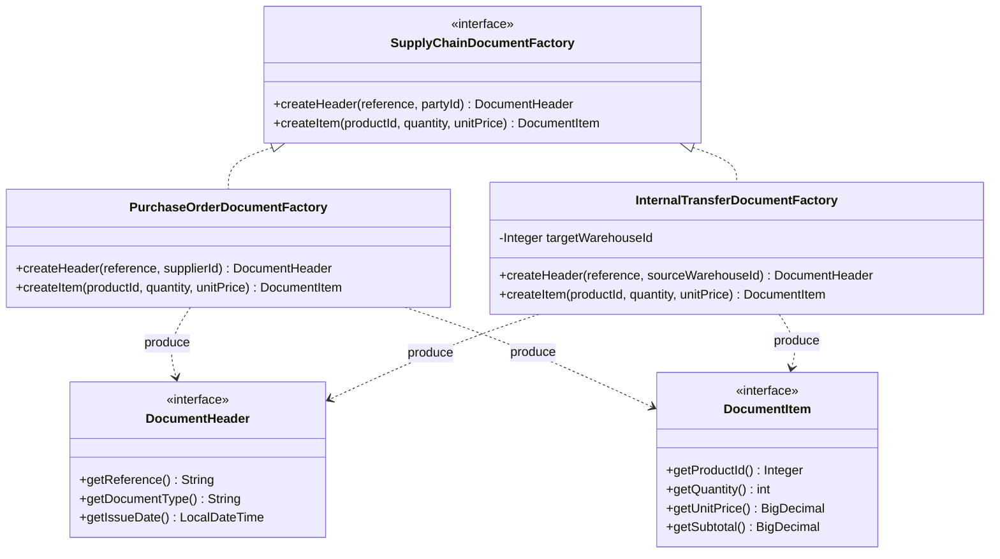

### C. Partes del Código donde está Aplicado
- `backend/sistema_cadena_suministro/src/main/java/com/logisync/sistema_cadena_suministro/domain/factory/document/SupplyChainDocumentFactory.java`
- `backend/sistema_cadena_suministro/src/main/java/com/logisync/sistema_cadena_suministro/domain/factory/document/PurchaseOrderDocumentFactory.java`
- `backend/sistema_cadena_suministro/src/main/java/com/logisync/sistema_cadena_suministro/domain/factory/document/InternalTransferDocumentFactory.java`
- `backend/sistema_cadena_suministro/src/main/java/com/logisync/sistema_cadena_suministro/domain/factory/document/DocumentHeader.java`
- `backend/sistema_cadena_suministro/src/main/java/com/logisync/sistema_cadena_suministro/domain/factory/document/DocumentItem.java`

### D. Responsabilidad de Cada Clase
- **`SupplyChainDocumentFactory`:** Declara los métodos de creación para los miembros de la familia de documentos.
- **`PurchaseOrderDocumentFactory`:** Fabrica cabeceras con proveedor y líneas de compra con precio unitario y cálculo de subtotal.
- **`InternalTransferDocumentFactory`:** Fabrica cabeceras con almacén origen/destino y líneas de traslado físico sin costo financiero.

### E. Cómo Probarlo y Verificar su Funcionamiento
- **Prueba Unitaria:** `src/test/java/com/logisync/sistema_cadena_suministro/domain/patterns/StructuralCreationalPatternsTest.java`
  - Método: `abstractFactoryCreatesConsistentDocumentFamilies()`
  - Verificación: Comprueba que la fábrica de compras produce documentos `PURCHASE_ORDER` con subtotales calculados y que la de traslados produce `INTERNAL_TRANSFER` sin costo monetario.

---

## 4. Patrón Builder (Constructor)

### A. Colaboración en el Proyecto y Problema Resuelto
- **Problema Resuelto:** Evitar el antipatrón de constructores telescópicos con múltiples parámetros y permitir la construcción fluida de comandos complejos y consultas paginadas con valores por defecto y validaciones de rango.
- **Colaboración:** Utilizado en `PageQuery` y comandos de creación (`CreateOrderCommand`, `CreatePurchaseOrderCommand`).

### B. Diagrama de Clases UML
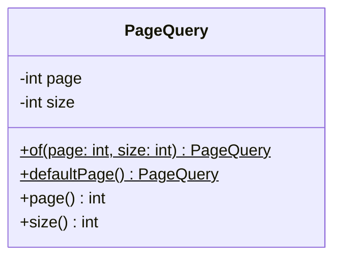

### C. Partes del Código donde está Aplicado
- `backend/sistema_cadena_suministro/src/main/java/com/logisync/sistema_cadena_suministro/application/pagination/PageQuery.java`
- `backend/sistema_cadena_suministro/src/main/java/com/logisync/sistema_cadena_suministro/application/commands/CreateOrderCommand.java`

### D. Responsabilidad de Cada Clase
- **`PageQuery`:** Valida y construye objetos de paginación asegurando que los números de página no sean negativos y limitando tamaños de lote máximos.

### E. Cómo Probarlo y Verificar su Funcionamiento
- Verificado en todos los endpoints GET paginados (`OrderController`, `PurchaseOrderController`, `ProductController`).

---

## 5. Patrón Prototype (Prototipo)

### A. Colaboración en el Proyecto y Problema Resuelto
- **Problema Resuelto:** En centros de distribución con cientos de estanterías (racks), recrear manualmente cada estructura con sus niveles y ubicaciones hijas representa una tarea propensa a errores y de alto costo en tiempo.
- **Colaboración:** Permite clonar plantillas estándar de racks preconfiguradas (`RackLayoutTemplate`) mediante el método `cloneSpace(...)`, realizando una copia en profundidad (*deep-clone*) de la lista de ubicaciones y permitiendo ajustar nombre y capacidad sin afectar el prototipo original.

### B. Diagrama de Clases UML
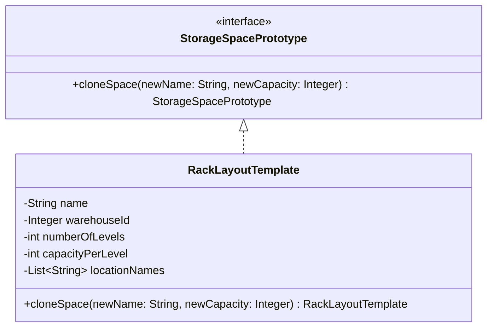

### C. Partes del Código donde está Aplicado
- `backend/sistema_cadena_suministro/src/main/java/com/logisync/sistema_cadena_suministro/domain/storage/prototype/StorageSpacePrototype.java`
- `backend/sistema_cadena_suministro/src/main/java/com/logisync/sistema_cadena_suministro/domain/storage/prototype/RackLayoutTemplate.java`

### D. Responsabilidad de Cada Clase
- **`StorageSpacePrototype`:** Interfaz que declara la capacidad de clonación del espacio de almacenamiento.
- **`RackLayoutTemplate`:** Prototipo concreto que realiza la copia profunda de los nombres de ubicaciones y niveles.

### E. Cómo Probarlo y Verificar su Funcionamiento
- **Prueba Unitaria:** `src/test/java/com/logisync/sistema_cadena_suministro/domain/patterns/StructuralCreationalPatternsTest.java`
  - Método: `prototypePatternClonesLayoutTemplatesDeeply()`
  - Verificación: Comprueba que `assertNotSame(template, clone)` es verdadero y que la lista de ubicaciones se replica independientemente.

---

# II. PATRONES ESTRUCTURALES

---

## 6. Patrón Adapter (Adaptador)

### A. Colaboración en el Proyecto y Problema Resuelto
- **Problema Resuelto:** Desacoplar la lógica pura de negocio de la tecnología de persistencia (Spring Data JPA, Hibernate, bases de datos relacionales SQL) y de los protocolos de comunicación externos (HTTP/REST).
- **Colaboración:** Es la base de la **Arquitectura Hexagonal**. El dominio define puertos de salida (ej. `OrderRepository`, `PurchaseOrderRepository`), y las clases `OrderAdapterPersistence`, `PurchaseOrderAdapterPersistence` actúan como adaptadores que implementan estos puertos y se comunican con los DAOs y entidades JPA de Spring.

### B. Diagrama de Clases UML
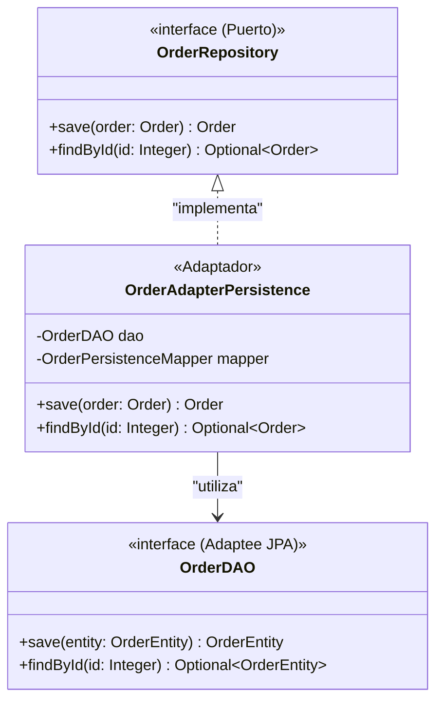

### C. Partes del Código donde está Aplicado
- `backend/sistema_cadena_suministro/src/main/java/com/logisync/sistema_cadena_suministro/infrastructure/persistence/adapters/OrderAdapterPersistence.java`
- `backend/sistema_cadena_suministro/src/main/java/com/logisync/sistema_cadena_suministro/infrastructure/persistence/adapters/PurchaseOrderAdapterPersistence.java`
- `backend/sistema_cadena_suministro/src/main/java/com/logisync/sistema_cadena_suministro/infrastructure/persistence/adapters/InventoryAdapterPersistence.java`

### D. Responsabilidad de Cada Clase
- **`OrderRepository` (Puerto Target):** Define las operaciones de almacenamiento requeridas por la lógica de negocio.
- **`OrderAdapterPersistence` (Adaptador):** Traduce modelos de dominio a entidades JPA y gestiona las llamadas con el DAO.
- **`OrderDAO` (Adaptee):** Interfaz Spring Data JPA que ejecuta las operaciones sobre la base de datos SQL.

### E. Cómo Probarlo y Verificar su Funcionamiento
- **Pruebas de Integración:** `OrderIntegrationTest`, `PurchaseOrderIntegrationTest`, `InventoryPersistenceIntegrationTest`.
  - Verificación: Comprueba que las llamadas que entran por el puerto de dominio persisten y recuperan datos en base de datos H2/MySQL sin filtrar detalles de JPA al dominio.

---

## 7. Patrón Bridge (Puente)

### A. Colaboración en el Proyecto y Problema Resuelto
- **Problema Resuelto:** Evitar la explosión combinatoria de subclases cuando existen dos dimensiones ortogonales que pueden variar de forma independiente: la forma en que se publica la telemetría (publicación estándar vs. alertas de emergencia urgentes) y el canal físico de destino (logs de servidor, streaming en memoria para SSE/WebSocket, o métricas Prometheus para Grafana).
- **Colaboración:** La abstracción `TelemetryPublication` mantiene una referencia al implementador `TelemetrySink`. Esto permite añadir nuevos tipos de publicaciones o nuevos sumideros de datos sin modificar el código existente.

### B. Diagrama de Clases UML
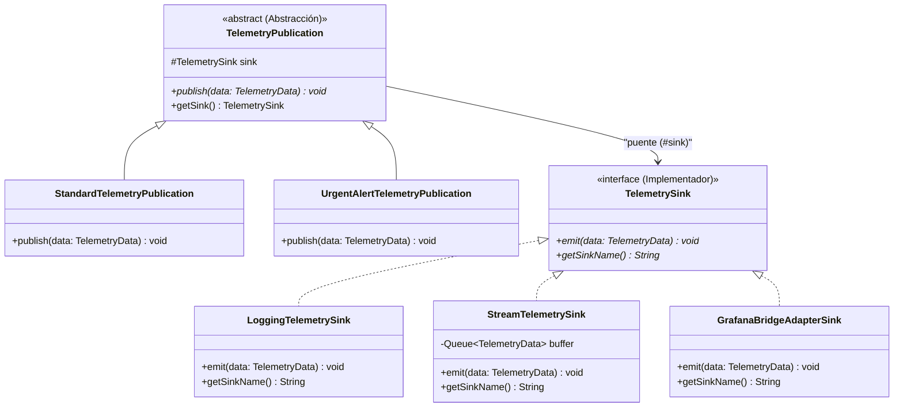

### C. Partes del Código donde está Aplicado
- `backend/sistema_cadena_suministro/src/main/java/com/logisync/sistema_cadena_suministro/domain/bridge/telemetry/TelemetryPublication.java`
- `backend/sistema_cadena_suministro/src/main/java/com/logisync/sistema_cadena_suministro/domain/bridge/telemetry/StandardTelemetryPublication.java`
- `backend/sistema_cadena_suministro/src/main/java/com/logisync/sistema_cadena_suministro/domain/bridge/telemetry/UrgentAlertTelemetryPublication.java`
- `backend/sistema_cadena_suministro/src/main/java/com/logisync/sistema_cadena_suministro/domain/bridge/telemetry/TelemetrySink.java`
- `backend/sistema_cadena_suministro/src/main/java/com/logisync/sistema_cadena_suministro/infrastructure/bridge/telemetry/LoggingTelemetrySink.java`
- `backend/sistema_cadena_suministro/src/main/java/com/logisync/sistema_cadena_suministro/infrastructure/bridge/telemetry/StreamTelemetrySink.java`
- `backend/sistema_cadena_suministro/src/main/java/com/logisync/sistema_cadena_suministro/infrastructure/bridge/telemetry/GrafanaBridgeAdapterSink.java`

### D. Responsabilidad de Cada Clase
- **`TelemetryPublication`:** Abstracción base que define el contrato de publicación de telemetría.
- **`StandardTelemetryPublication` / `UrgentAlertTelemetryPublication`:** Abstracciones refinadas con lógica de despacho normal o prioritario.
- **`TelemetrySink`:** Interfaz común para todos los canales de destino.
- **`LoggingTelemetrySink`, `StreamTelemetrySink`, `GrafanaBridgeAdapterSink`:** Implementadores concretos para logs, colas de streaming en memoria y exportación a Grafana.

### E. Cómo Probarlo y Verificar su Funcionamiento
- **Prueba Unitaria:** `src/test/java/com/logisync/sistema_cadena_suministro/domain/patterns/StructuralCreationalPatternsTest.java`
  - Método: `bridgePatternDecouplesPublicationFromSink()`
  - Verificación: Comprueba que una publicación puede emitirse hacia el `StreamTelemetrySink` (llenando la cola en memoria) o hacia el `LoggingTelemetrySink` sin acoplamiento.

---

## 8. Patrón Composite (Objeto Compuesto)

### A. Colaboración en el Proyecto y Problema Resuelto
- **Problema Resuelto:** Representar la estructura física jerárquica de almacenamiento de un almacén en árbol sin que el cliente tenga que escribir código condicional para distinguir si está tratando con un almacén, una zona, una estantería (rack) o una ubicación individual.
- **Colaboración:** Permite calcular capacidades agregadas totales y recorrer la estructura física mediante una única interfaz polimórfica (`StorageNode`).

### B. Diagrama de Clases UML
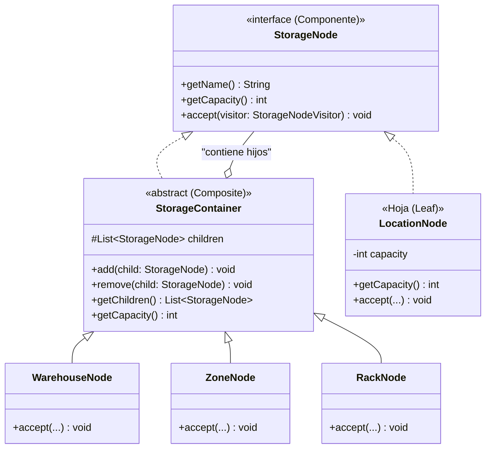

### C. Partes del Código donde está Aplicado
- `backend/sistema_cadena_suministro/src/main/java/com/logisync/sistema_cadena_suministro/domain/storage/StorageNode.java`
- `backend/sistema_cadena_suministro/src/main/java/com/logisync/sistema_cadena_suministro/domain/storage/StorageContainer.java`
- `backend/sistema_cadena_suministro/src/main/java/com/logisync/sistema_cadena_suministro/domain/storage/WarehouseNode.java`
- `backend/sistema_cadena_suministro/src/main/java/com/logisync/sistema_cadena_suministro/domain/storage/ZoneNode.java`
- `backend/sistema_cadena_suministro/src/main/java/com/logisync/sistema_cadena_suministro/domain/storage/RackNode.java`
- `backend/sistema_cadena_suministro/src/main/java/com/logisync/sistema_cadena_suministro/domain/storage/LocationNode.java`

### D. Responsabilidad de Cada Clase
- **`StorageNode`:** Declara la interfaz común para nodos compuestos y hojas.
- **`StorageContainer`:** Implementa la gestión de nodos hijos y realiza el cálculo recursivo de capacidad sumando las capacidades de sus hijos.
- **`WarehouseNode`, `ZoneNode`, `RackNode`:** Representan niveles de agrupación en el almacén.
- **`LocationNode` (Hoja):** Representa la posición final física donde se almacena el stock.

### E. Cómo Probarlo y Verificar su Funcionamiento
- **Prueba Unitaria:** `src/test/java/com/logisync/sistema_cadena_suministro/domain/storage/StorageCompositeTest.java`
  - Método: `calculatesAggregatedCapacities()`
  - Verificación: Comprueba que la capacidad total reportada por `WarehouseNode` es la suma exacta de las `LocationNode` hojas contenidas en sus racks.

---

## 9. Patrón Decorator (Decorador)

### A. Colaboración en el Proyecto y Problema Resuelto
- **Problema Resuelto:** Agregar dinámicamente reglas comerciales variables de tarificación sobre pedidos de clientes (descuentos por volumen, recargos de envío exprés, impuestos/IVA) sin crear una subclase rígida por cada posible combinación.
- **Colaboración:** El decorador envuelve al calculador base (`BaseOrderPricingCalculator`) y permite apilar consecutivamente en tiempo de ejecución cualquier número de modificadores de precio.

### B. Diagrama de Clases UML
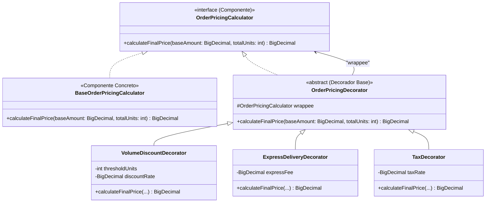

### C. Partes del Código donde está Aplicado
- `backend/sistema_cadena_suministro/src/main/java/com/logisync/sistema_cadena_suministro/domain/decorator/pricing/OrderPricingCalculator.java`
- `backend/sistema_cadena_suministro/src/main/java/com/logisync/sistema_cadena_suministro/domain/decorator/pricing/BaseOrderPricingCalculator.java`
- `backend/sistema_cadena_suministro/src/main/java/com/logisync/sistema_cadena_suministro/domain/decorator/pricing/OrderPricingDecorator.java`
- `backend/sistema_cadena_suministro/src/main/java/com/logisync/sistema_cadena_suministro/domain/decorator/pricing/VolumeDiscountDecorator.java`
- `backend/sistema_cadena_suministro/src/main/java/com/logisync/sistema_cadena_suministro/domain/decorator/pricing/ExpressDeliveryDecorator.java`
- `backend/sistema_cadena_suministro/src/main/java/com/logisync/sistema_cadena_suministro/domain/decorator/pricing/TaxDecorator.java`

### D. Responsabilidad de Cada Clase
- **`OrderPricingCalculator`:** Define la interfaz para el cálculo monetario.
- **`BaseOrderPricingCalculator`:** Retorna el precio base sin modificaciones.
- **`OrderPricingDecorator`:** Delega en el objeto envuelto (`wrappee`).
- **`VolumeDiscountDecorator`:** Aplica porcentaje de descuento si el número de unidades supera el umbral.
- **`ExpressDeliveryDecorator`:** Adiciona una tarifa fija de transporte preferente.
- **`TaxDecorator`:** Calcula y añade la alícuota de impuesto (IVA).

### E. Cómo Probarlo y Verificar su Funcionamiento
- **Prueba Unitaria:** `src/test/java/com/logisync/sistema_cadena_suministro/domain/patterns/StructuralCreationalPatternsTest.java`
  - Método: `decoratorPatternCalculatesPricingWithDiscountsAndFees()`
  - Verificación: Comprueba que encadenar `base (100.00)` -> `descuento 10% (90.00)` -> `envío (+15.00 -> 105.00)` -> `IVA 19%` produce exactamente `124.95`.

---

## 10. Patrón Facade (Fachada)

### A. Colaboración en el Proyecto y Problema Resuelto
- **Problema Resuelto:** El subsistema de la cadena de suministro contiene múltiples puertos y casos de uso aislados (crear órdenes de compra, validar cadenas de reglas, recibir mercancía en ubicaciones físicas, registrar movimientos de entrada y consultar disponibilidad de stock). Exponer todos estos casos de uso a controladores de alto nivel o clientes externos genera alto acoplamiento.
- **Colaboración:** La fachada `SupplyChainOperationsFacade` proporciona métodos sencillos y de alto nivel que orquestan de manera coordinada compras con recepción automática, colocación de pedidos y consultas consolidadas de stock en una sola llamada transaccional.

### B. Diagrama de Clases UML
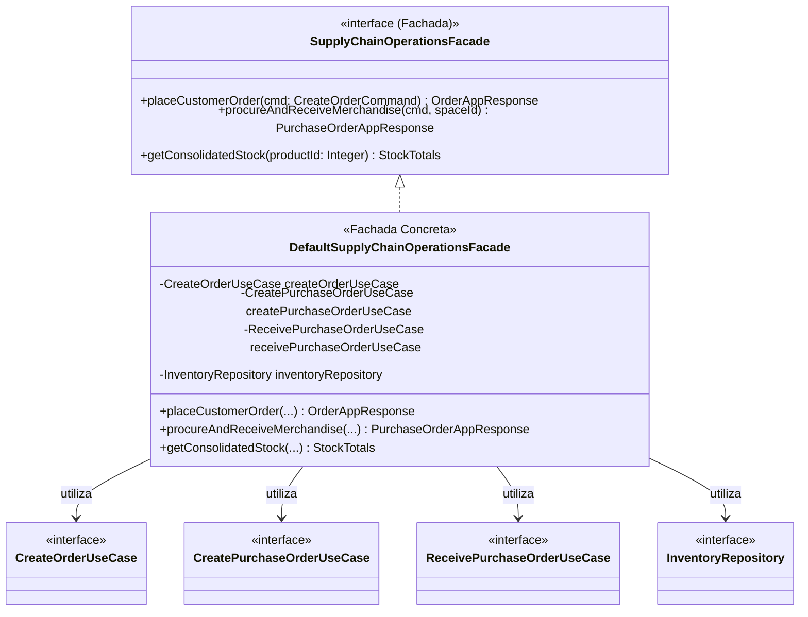

### C. Partes del Código donde está Aplicado
- `backend/sistema_cadena_suministro/src/main/java/com/logisync/sistema_cadena_suministro/application/facade/SupplyChainOperationsFacade.java`
- `backend/sistema_cadena_suministro/src/main/java/com/logisync/sistema_cadena_suministro/application/facade/DefaultSupplyChainOperationsFacade.java`

### D. Responsabilidad de Cada Clase
- **`SupplyChainOperationsFacade`:** Expone la API de alto nivel para operaciones consolidadas.
- **`DefaultSupplyChainOperationsFacade`:** Implementa la orquestación coordinando la creación de la orden de compra, la recepción en la ubicación especificada y la consulta transaccional de stock.

### E. Cómo Probarlo y Verificar su Funcionamiento
- **Prueba de Integración:** `src/test/java/com/logisync/sistema_cadena_suministro/infrastructure/facade/SupplyChainOperationsFacadeIntegrationTest.java`
  - Método: `facadeOrchestratesProcurementAndOrdersSimultaneously()`
  - Verificación: Comprueba que a través de la fachada se ejecuta el ciclo completo: compra -> recepción automática en almacén -> validación de stock consolidado -> colocación de pedido contra el stock recibido.

---

## 11. Patrón Flyweight (Peso Ligero)

### A. Colaboración en el Proyecto y Problema Resuelto
- **Problema Resuelto:** En operaciones logísticas de alto volumen, se registran miles de movimientos de inventario diarios (entradas, salidas, traslados, ajustes). Instanciar un objeto nuevo para describir el tipo de movimiento en cada fila crearía una sobrecarga innecesaria en el recolector de basura (GC).
- **Colaboración:** El estado intrínseco (inmutable y repetitivo: código, etiqueta legible y si requiere motivo obligatorio) se extrae en la clase `MovementType`, administrada por `MovementTypeFactory`. Toda la aplicación comparte exactamente las mismas 4 instancias en memoria.

### B. Diagrama de Clases UML
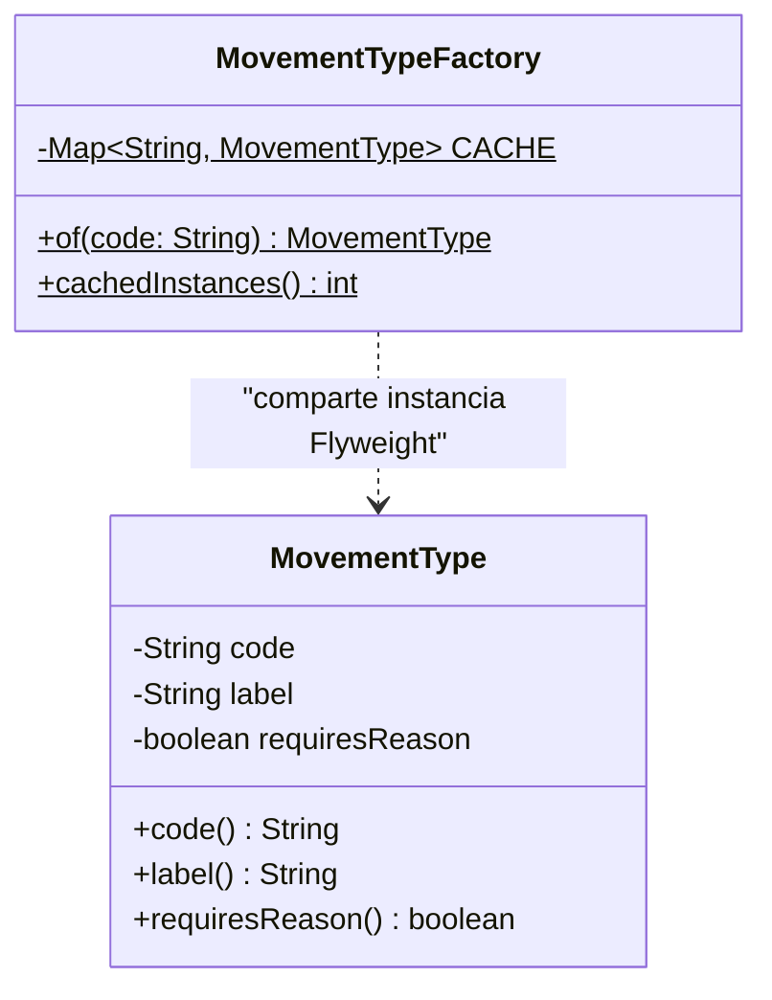

### C. Partes del Código donde está Aplicado
- `backend/sistema_cadena_suministro/src/main/java/com/logisync/sistema_cadena_suministro/domain/inventory/MovementType.java`
- `backend/sistema_cadena_suministro/src/main/java/com/logisync/sistema_cadena_suministro/domain/inventory/MovementTypeFactory.java`

### D. Responsabilidad de Cada Clase
- **`MovementType` (Flyweight):** Almacena el estado intrínseco inmutable común.
- **`MovementTypeFactory` (Fábrica Flyweight):** Controla la entrega de las instancias desde una tabla hash estática concurrente.

### E. Cómo Probarlo y Verificar su Funcionamiento
- **Prueba Unitaria:** `src/test/java/com/logisync/sistema_cadena_suministro/domain/inventory/MovementTypeFactoryTest.java`
  - Métodos: `returnsTheSameSharedInstancePerCode()` y `cachedInstances()` comprobando que el número total de instancias nunca excede 4.

---

## 12. Patrón Proxy (Sustituto / Intermediario)

### A. Colaboración en el Proyecto y Problema Resuelto
- **Problema Resuelto:** Los algoritmos de optimización de rutas entre múltiples paradas de despacho son computacionalmente costosos. Recomputar la misma ruta repetidas veces cuando el origen y los destinos no han variado desperdicia ciclos de CPU del servidor.
- **Colaboración:** El proxy `CachedRouteCalculationProxy` implementa la misma interfaz `RouteCalculationService` que el servicio real. Intercepta las solicitudes, genera una clave compuesta de la ruta y responde de inmediato en caso de acierto de caché (*cache hit*) marcando la respuesta con `fromCache = true`, además de auditar métricas de latencia de cómputo.

### B. Diagrama de Clases UML
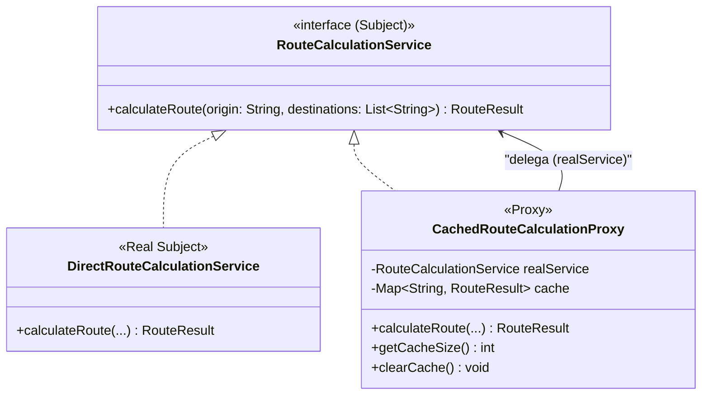

### C. Partes del Código donde está Aplicado
- `backend/sistema_cadena_suministro/src/main/java/com/logisync/sistema_cadena_suministro/domain/proxy/routing/RouteCalculationService.java`
- `backend/sistema_cadena_suministro/src/main/java/com/logisync/sistema_cadena_suministro/domain/proxy/routing/DirectRouteCalculationService.java`
- `backend/sistema_cadena_suministro/src/main/java/com/logisync/sistema_cadena_suministro/domain/proxy/routing/CachedRouteCalculationProxy.java`

### D. Responsabilidad de Cada Clase
- **`RouteCalculationService` (Subject):** Contrato común para el cálculo de rutas.
- **`DirectRouteCalculationService` (Real Subject):** Realiza el cálculo real de distancia y estimación de tiempos.
- **`CachedRouteCalculationProxy` (Proxy):** Intercepta la petición, valida la caché en memoria, registra tiempos de ejecución y delega únicamente ante *cache miss*.

### E. Cómo Probarlo y Verificar su Funcionamiento
- **Prueba Unitaria:** `src/test/java/com/logisync/sistema_cadena_suministro/domain/patterns/StructuralCreationalPatternsTest.java`
  - Método: `proxyPatternProvidesTransparentCaching()`
  - Verificación: Comprueba que en la primera llamada `firstCall.fromCache()` es falso (calculado en el servicio real) y en la segunda llamada idéntica `secondCall.fromCache()` es verdadero (servido por el proxy).

---

## Resumen de Ubicación de Archivos Generados
1. Documento Word `.docx` listo para entrega / adjunto:
   - `docs/Guia_Patrones_Creacionales_y_Estructurales_LogiSync.docx`
2. Documento Markdown `.md` con diagramas Mermaid para lectura y copiado rápido:
   - `docs/GUIA_PATRONES_CREACIONALES_Y_ESTRUCTURALES.md`
