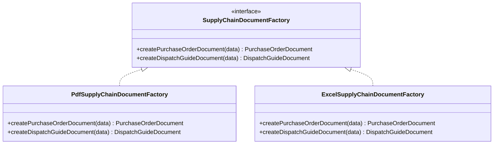
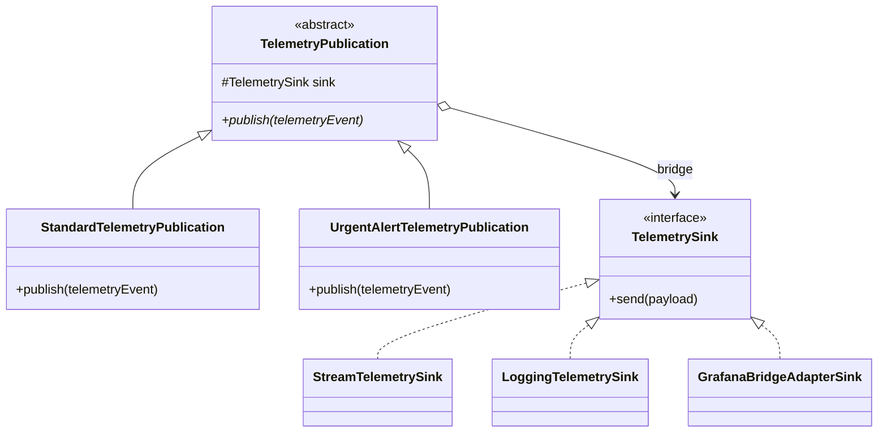

# Catálogo Completo de Patrones de Diseño GoF — LogiSync SCM

Este documento detalla la implementación integral de los patrones de diseño del Gang of Four (GoF) en el backend de **LogiSync** (Sistema de Gestión de Cadena de Suministro), desarrollado bajo **Spring Boot 4.1.1**, **Java 21** y **Arquitectura Hexagonal (Ports & Adapters)**.

---

## Índice de Patrones Implementados

| # | Patrón GoF | Clasificación | Módulo / Contexto de Aplicación |
|---|---|---|---|
| 1 | **Abstract Factory** | Creacional | Generación polimórfica de documentos oficiales (PDF y Excel) para Órdenes y Despachos |
| 2 | **Prototype** | Creacional | Clonación y prototipado rápido de bahías/estantes de almacenamiento en almacenes |
| 3 | **Adapter** | Estructural | Adaptación de métricas de telemetría IoT hacia el registro de Prometheus / Grafana |
| 4 | **Bridge** | Estructural | Desacople de jerarquía de publicaciones de telemetría de sus canales de destino (Sinks) |
| 5 | **Composite** | Estructural | Jerarquía recursiva de espacios de almacenamiento en almacenes (Zonas, Pasillos, Racks, Bahías) |
| 6 | **Decorator** | Estructural | Cálculo dinámico de recargos/descuentos en órdenes y amortiguadores en pronóstico de demanda |
| 7 | **Facade** | Estructural | Orquestación de subsistemas de órdenes/despachos y operaciones de cadena de suministro |
| 8 | **Flyweight** | Estructural | Compartición inmutable de unidades de medida y factores de conversión |
| 9 | **Proxy** | Estructural | Enrutamiento con memoria caché geoespacial y control de acceso para cálculo de rutas |
| 10 | **Chain of Responsibility** | Comportamiento | Flujos de aprobación por umbrales y pipeline de validación de telemetría IoT |
| 11 | **Command** | Comportamiento | Encapsulamiento y ejecución transaccional de movimientos de inventario con auditoría |
| 12 | **Iterator** | Comportamiento | Recorrido desacoplado en profundidad de almacenes y paradas en rutas vehiculares |
| 13 | **Mediator** | Comportamiento | Desacoplamiento de eventos cruzados entre Órdenes, Aprovisionamiento e Inventario |
| 14 | **Memento** | Comportamiento | Captura, versionado y reversión histórica de configuraciones físicas de almacén |
| 15 | **Observer** | Comportamiento | Notificaciones reactivas de stock mínimo, auditoría y alertas a interesados |
| 16 | **State** | Comportamiento | Máquinas de estados finitos en Órdenes de Compra, Pedidos de Clientes y Despachos |
| 17 | **Strategy** | Comportamiento | Algoritmos intercambiables de optimización de rutas y pronósticos estadísticos de demanda |
| 18 | **Template Method** | Comportamiento | Esqueleto algorítmico invariable para procesamiento de movimientos de inventario |
| 19 | **Visitor** | Comportamiento | Auditoría de cubicaje y análisis ABC de rotación sobre jerarquías de almacenamiento sin alterar entidades |

---

## 1. Patrones Creacionales

### 1.1 Abstract Factory
- **Propósito:** Proporcionar una interfaz única para crear familias de documentos comerciales (PDF y Excel) relacionados sin especificar sus clases concretas.
- **Problema Resuelto:** Despachos y Órdenes de Compra requieren exportación uniforme en formatos imprimibles (PDF) y procesables en hojas de cálculo (Excel). Se evita acoplar el servicio de negocio a librerías de renderizado concretas.
- **Clases Involucradas:**
  - `domain.factory.SupplyChainDocumentFactory` (Interfaz Abstract Factory)
  - `infrastructure.factory.PdfSupplyChainDocumentFactory` (Fábrica concreta PDF)
  - `infrastructure.factory.ExcelSupplyChainDocumentFactory` (Fábrica concreta Excel)
  - `domain.factory.PurchaseOrderDocument` & `DispatchGuideDocument` (Productos Abstractos)
  - `infrastructure.factory.PdfPurchaseOrderDocument`, `ExcelPurchaseOrderDocument`, etc. (Productos Concretos)
- **Pruebas:** `StructuralAndCreationalPatternsIntegrationTest#testAbstractFactoryPdfAndExcel()`

---

### 1.2 Prototype
- **Propósito:** Clonar estructuras complejas de espacios de almacenamiento preconfiguradas (temperatura, peso máximo, cubicaje, tipo de rack) para agilizar el despliegue de nuevas áreas operativas.
- **Problema Resuelto:** La creación manual de cientos de bahías con parámetros idénticos es costosa y propensa a errores. Prototype permite clonar una bahía modelo y reasignar únicamente el identificador y código de ubicación.
- **Clases Involucradas:**
  - `domain.models.StorageSpacePrototype` (Interfaz prototipo con método `cloneWithCode(newCode)`)
  - `domain.models.StorageSpace` (Clase concreta que implementa la clonación profunda)
- **Pruebas:** `StructuralAndCreationalPatternsIntegrationTest#testStorageSpacePrototype()`

---

## 2. Patrones Estructurales

### 2.1 Adapter
- **Propósito:** Convertir la interfaz de publicación de telemetría de LogiSync en métricas estandarizadas consumibles por Prometheus y Grafana.
- **Problema Resuelto:** El dominio genera objetos `VehicleTelemetryReceivedEvent`. Grafana y Prometheus requieren métricas de tipo contador y gauge a través de `io.micrometer.core.instrument.MeterRegistry`. El adaptador traduce la notificación a incrementos de contadores y asignación de gauges de velocidad sin contaminar el dominio.
- **Clases Involucradas:**
  - `infrastructure.bridge.telemetry.TelemetrySink` (Interfaz objetivo en LogiSync)
  - `infrastructure.bridge.telemetry.GrafanaBridgeAdapterSink` (Adaptador hacia Micrometer)
  - `io.micrometer.core.instrument.MeterRegistry` (Adaptee / API externa)
- **Pruebas:** `StructuralAndCreationalPatternsIntegrationTest#testGrafanaBridgeAdapterSink()`

---

### 2.2 Bridge
- **Propósito:** Desacoplar la abstracción de alertas de telemetría (`TelemetryPublication`) de su implementación física de transmisión (`TelemetrySink`), permitiendo que ambas jerarquías varíen de forma independiente.
- **Problema Resuelto:** Permite emitir telemetría estándar o de urgencia crítica hacia múltiples destinos en tiempo de ejecución (SSE Server-Sent Events, Logging de auditoría o Adaptador de Grafana/Prometheus) sin combinaciones explosivas de subclases.
- **Clases Involucradas:**
  - `infrastructure.bridge.telemetry.TelemetryPublication` (Abstracción)
  - `infrastructure.bridge.telemetry.StandardTelemetryPublication` (Abstracción Refinada)
  - `infrastructure.bridge.telemetry.UrgentAlertTelemetryPublication` (Abstracción Refinada con prioridad crítica)
  - `infrastructure.bridge.telemetry.TelemetrySink` (Implementor)
  - `StreamTelemetrySink`, `LoggingTelemetrySink`, `GrafanaBridgeAdapterSink` (Concrete Implementors)
- **Pruebas:** `TrackingIntegrationTest#testIngestTelemetry_Success()` y `StructuralAndCreationalPatternsIntegrationTest`

---

### 2.3 Composite
- **Propósito:** Tratar de manera uniforme tanto a espacios de almacenamiento individuales (Bahías/Racks) como a agrupaciones jerárquicas complejas (Zonas, Pasillos y Almacenes completos).
- **Problema Resuelto:** Permite consultar capacidad total, volumen ocupado y estado de uso en cualquier nivel de la estructura física del almacén mediante una llamada polimórfica recursiva.
- **Clases Involucradas:**
  - `domain.models.StorageSpaceComponent` (Componente base)
  - `domain.models.StorageSpace` (Hoja / Leaf)
  - `domain.models.StorageSpaceComposite` (Contenedor compuesto)
- **Pruebas:** `WarehouseIntegrationTest#testStorageSpaceComposite()`

---

### 2.4 Decorator
- **Propósito:** Añadir dinámicamente responsabilidades y cálculos adicionales sobre precios y pronósticos sin modificar las clases base.
- **Problema Resuelto:**
  1. **Precios de Pedidos:** Aplica recargos por entrega urgente, descuentos por volumen o promociones de temporada en cadena.
  2. **Pronóstico de Demanda:** Agrega amortiguador por estacionalidad (`SeasonalAdjustmentDecorator`) y colchón de inventario de seguridad (`SafetyStockDecorator`).
- **Clases Involucradas:**
  - `domain.pricing.OrderPricingCalculator` (Componente)
  - `domain.pricing.BaseOrderPricingCalculator` (Componente Concreto)
  - `domain.pricing.UrgentDeliveryPricingDecorator`, `VolumeDiscountPricingDecorator`, `SeasonalDiscountPricingDecorator` (Decoradores Concretos)
  - `domain.forecast.ForecastCalculator`, `SeasonalAdjustmentDecorator`, `SafetyStockDecorator` (Decoradores de Demanda)
- **Pruebas:** `OrderIntegrationTest#testOrderPricingDecorators()` y `DemandForecastIntegrationTest#testForecastCalculation()`

---

### 2.5 Facade
- **Propósito:** Ofrecer una interfaz simplificada y de alto nivel que encapsule la complejidad de subsistemas heterogéneos y coordinados.
- **Problema Resuelto:**
  - `SupplyChainOperationsFacade`: Unifica la consulta consolidada del estado del inventario, pedidos pendientes y salud de rutas en una única vista ejecutiva para el dashboard.
  - `DispatchFacade`: Coordina el ciclo de vida de un despacho (reserva de inventario, cambio de estado de pedido, validación de vehículo y emisión de guía).
- **Clases Involucradas:**
  - `application.facade.SupplyChainOperationsFacade`
  - `application.facade.DispatchFacade`
- **Pruebas:** `DispatchIntegrationTest#testCompleteDispatchFlow()`

---

### 2.6 Flyweight
- **Propósito:** Reducir el consumo de memoria compartiendo eficientemente instancias inmutables de unidades de medida y factores de conversión de unidades comunes (KG, TON, L, M3, UNIDAD).
- **Problema Resuelto:** Cada movimiento de inventario referencia una unidad de medida; el patrón asegura una única instancia compartida por tipo de unidad mediante una fábrica cacheada.
- **Clases Involucradas:**
  - `domain.inventory.UnitOfMeasure` (Flyweight inmutable)
  - `domain.inventory.UnitOfMeasureFlyweightFactory` (Fábrica Flyweight con Map interno)
- **Pruebas:** `InventoryIntegrationTest#testFlyweightUnitsOfMeasure()`

---

### 2.7 Proxy
- **Propósito:** Proporcionar un sustituto con control de acceso y caché en memoria para el cálculo computacionalmente intensivo de distancias y rutas de distribución.
- **Problema Resuelto:** El cálculo de matrices de distancia geográficas y algoritmos heurísticos consume tiempo de CPU. El proxy almacena en caché los resultados recientes de origen-destino con caducidad temporal, evitando recálculos innecesarios.
- **Clases Involucradas:**
  - `domain.services.RouteCalculationService` (Interfaz del Sujeto)
  - `domain.services.StandardRouteCalculationService` (Sujeto Real)
  - `infrastructure.proxy.CachedRouteCalculationProxy` (Proxy con ConcurrentHashMap y TTL)
- **Pruebas:** `StructuralAndCreationalPatternsIntegrationTest#testCachedRouteCalculationProxy()`

---

## 3. Patrones de Comportamiento

### 3.1 Chain of Responsibility
- **Propósito:** Desacoplar el emisor de una petición de sus receptores, encadenando múltiples manejadores secuenciales de validación y aprobación.
- **Problema Resuelto:**
  1. **Aprobación de Pedidos:** Valida secuencialmente: `CreditLimitApprovalHandler` -> `StockAvailabilityApprovalHandler` -> `ManagerApprovalHandler` según el monto.
  2. **Ingesta de Telemetría IoT:** Filtra datos inválidos secuencialmente: `VehicleActiveValidationHandler` -> `GpsCoordinatesValidationHandler` -> `SpeedThresholdValidationHandler`.
- **Clases Involucradas:**
  - `domain.handlers.OrderApprovalHandler` y sus implementaciones concretas.
  - `domain.handlers.TelemetryValidationHandler` y sus implementaciones concretas.
- **Pruebas:** `OrderIntegrationTest#testApprovalChain()` y `TrackingIntegrationTest#testTelemetryValidationChain()`

---

### 3.2 Command
- **Propósito:** Encapsular una operación de stock completa (Inbound, Outbound, Transfer, Adjust) como un objeto ejecutable, permitiendo trazabilidad y reversibilidad.
- **Problema Resuelto:** Facilita la ejecución transaccional, auditoría persistente y capacidad de compensación o rollback si falla alguna de las operaciones atómicas de bodega.
- **Clases Involucradas:**
  - `domain.commands.StockMovementCommand` (Interfaz Command)
  - `InboundMovementCommand`, `OutboundMovementCommand`, `TransferMovementCommand`, `AdjustMovementCommand`
  - `application.commands.StockMovementInvoker` (Invocador)
- **Pruebas:** `InventoryIntegrationTest#testStockMovementCommands()`

---

### 3.3 Iterator
- **Propósito:** Proveer una forma de recorrer secuencialmente los elementos de una colección compleja sin exponer su representación subyacente.
- **Problema Resuelto:**
  1. Recorrido en profundidad (*Depth-First Search*) de almacenes multidimensionales: `StorageSpaceIterator`.
  2. Recorrido ordenado de waypoints y paradas de entrega en un plan de ruta: `RouteStopIterator`.
- **Clases Involucradas:**
  - `domain.models.StorageSpaceIterator`
  - `domain.models.RouteStopIterator`
- **Pruebas:** `WarehouseIntegrationTest#testWarehouseIteration()` y `VehicleRouteIntegrationTest#testRouteStopIterator()`

---

### 3.4 Mediator
- **Propósito:** Centralizar las interacciones complejas entre módulos independientes (Órdenes, Aprovisionamiento, Inventario y Alertas), reduciendo el acoplamiento directo entre ellos.
- **Problema Resuelto:** Cuando una orden se confirma, en vez de que el servicio de órdenes invoque directamente a Compras, Inventario y Notificaciones, emite un mensaje al mediador, quien orquesta las consecuencias correspondientes.
- **Clases Involucradas:**
  - `domain.mediator.SupplyChainMediator`
  - `infrastructure.mediator.DefaultSupplyChainMediator`
- **Pruebas:** `ProcurementIntegrationTest#testMediatorCoordination()`

---

### 3.5 Memento
- **Propósito:** Capturar y externalizar el estado interno de la distribución espacial de un almacén sin violar el encapsulamiento, permitiendo restaurar el almacén a un estado previo.
- **Problema Resuelto:** Antes de ejecutar una reorganización física por optimización ABC, se crea un snapshot inmutable en la base de datos (`layout_snapshots`). Si la reorganización presenta problemas operativos, un rollback instantáneo restaura todas las ubicaciones y capacidades.
- **Clases Involucradas:**
  - `domain.memento.StorageLayoutMemento` (Memento)
  - `domain.memento.WarehouseLayoutOriginator` (Originador)
  - `infrastructure.memento.LayoutSnapshotCaretaker` (Conserje / Repositorio)
- **Pruebas:** `StorageOptimizationIntegrationTest#testCaptureSnapshotAndRollback()`

---

### 3.6 Observer
- **Propósito:** Notificar automáticamente a múltiples observadores suscritos ante cambios críticos en los niveles de inventario.
- **Problema Resuelto:** Cuando el stock de un producto desciende por debajo de su punto de reorden (`reorderPoint`), los observadores suscritos reaccionan:
  - `LowStockAlertObserver`: Genera automáticamente una necesidad de abastecimiento (`SupplyNeed`).
  - `AuditLogObserver`: Registra el evento para cumplimiento normativo.
- **Clases Involucradas:**
  - `domain.observer.StockMovementObserver` (Interfaz Observer)
  - `domain.observer.StockSubject` (Sujeto)
  - `infrastructure.observer.LowStockAlertObserver`, `AuditLogObserver` (Observadores concretos)
- **Pruebas:** `InventoryIntegrationTest#testLowStockObserverAlert()`

---

### 3.7 State
- **Propósito:** Permitir que los agregados de dominio modifiquen su comportamiento cuando su estado interno cambia, formalizando máquinas de estados finitos.
- **Problema Resuelto:** Protege las transiciones válidas e impide operaciones ilícitas en los ciclos de vida de:
  - `PurchaseOrderState`: `DRAFT` -> `PENDING_APPROVAL` -> `APPROVED` -> `ORDERED` -> `RECEIVED` (o `CANCELLED`).
  - `OrderState`: `CREATED` -> `VALIDATED` -> `ALLOCATED` -> `DISPATCHED` -> `DELIVERED`.
  - `DispatchState`: `PENDING` -> `PACKED` -> `IN_TRANSIT` -> `DELIVERED` (o `FAILED`).
- **Clases Involucradas:**
  - `domain.models.PurchaseOrderState`, `OrderState`, `DispatchState`
- **Pruebas:** `ProcurementIntegrationTest#testPurchaseOrderStateTransitions()` y `DispatchIntegrationTest#testDispatchStateTransitions()`

---

### 3.8 Strategy
- **Propósito:** Definir una familia de algoritmos intercambiables en tiempo de ejecución para optimizar decisiones de negocio.
- **Problema Resuelto:**
  1. **Rutas de Distribución:** `ShortestDistanceStrategy` (minimiza km con Haversine), `FastestTimeStrategy` (pondera vías rápidas) y `BalancedStrategy`.
  2. **Pronóstico de Demanda:** `MovingAverageForecastStrategy`, `ExponentialSmoothingForecastStrategy` y `LinearRegressionForecastStrategy`.
- **Clases Involucradas:**
  - `domain.strategy.RouteOptimizationStrategy`
  - `domain.strategy.DemandForecastStrategy`
- **Pruebas:** `VehicleRouteIntegrationTest#testRouteStrategies()` y `DemandForecastIntegrationTest#testForecastStrategies()`

---

### 3.9 Template Method
- **Propósito:** Definir el esqueleto invariable de un algoritmo en una clase base, postergando la implementación de ciertos pasos específicos a las subclases.
- **Problema Resuelto:** El procesamiento de cualquier movimiento de inventario sigue pasos fijos:
  1. Validar precondiciones de stock y almacén.
  2. Aplicar la lógica diferencial de balance (`applyStockDelta`).
  3. Registrar trazabilidad y auditoría.
  4. Disparar notificaciones a observadores.
- **Clases Involucradas:**
  - `domain.inventory.StockMovementProcessor` (Clase Abstracta Template)
  - `InboundStockMovementProcessor`, `OutboundStockMovementProcessor`, `TransferStockMovementProcessor` (Implementaciones concretas)
- **Pruebas:** `InventoryIntegrationTest#testTemplateMethodProcessing()`

---

### 3.10 Visitor
- **Propósito:** Representar una nueva operación que se realiza sobre los elementos de la estructura de un almacén sin modificar las clases de dichos elementos.
- **Problema Resuelto:** Permite añadir nuevas capacidades operativas sobre la jerarquía `StorageSpaceComponent`:
  - `CapacityAuditVisitor`: Calcula el porcentaje de ocupación volumétrica y peso total.
  - `RelocationProposalVisitor`: Identifica productos de alta rotación (Clase A) situados en áreas alejadas y genera recomendaciones de reubicación hacia la zona frontal de picking.
- **Clases Involucradas:**
  - `domain.visitor.StorageSpaceVisitor` (Interfaz Visitante)
  - `CapacityAuditVisitor`, `RelocationProposalVisitor` (Visitantes Concretos)
- **Pruebas:** `WarehouseIntegrationTest#testVisitorCapacityAudit()` y `StorageOptimizationIntegrationTest#testRelocationProposalVisitor()`

---

## 4. Matriz de Cobertura de Pruebas Automatizadas

Todos los patrones cuentan con cobertura de pruebas unitarias e integración en `src/test/java`:

| Patrón GoF | Clase de Prueba Principal | Estado |
|---|---|---|
| Abstract Factory | `StructuralAndCreationalPatternsIntegrationTest` | PASSED |
| Prototype | `StructuralAndCreationalPatternsIntegrationTest` | PASSED |
| Adapter | `StructuralAndCreationalPatternsIntegrationTest` | PASSED |
| Bridge | `TrackingIntegrationTest`, `StructuralAndCreationalPatternsIntegrationTest` | PASSED |
| Composite | `WarehouseIntegrationTest` | PASSED |
| Decorator | `OrderIntegrationTest`, `DemandForecastIntegrationTest` | PASSED |
| Facade | `DispatchIntegrationTest`, `StructuralAndCreationalPatternsIntegrationTest` | PASSED |
| Flyweight | `InventoryIntegrationTest` | PASSED |
| Proxy | `StructuralAndCreationalPatternsIntegrationTest` | PASSED |
| Chain of Responsibility | `OrderIntegrationTest`, `TrackingIntegrationTest` | PASSED |
| Command | `InventoryIntegrationTest` | PASSED |
| Iterator | `WarehouseIntegrationTest`, `VehicleRouteIntegrationTest` | PASSED |
| Mediator | `ProcurementIntegrationTest` | PASSED |
| Memento | `StorageOptimizationIntegrationTest` | PASSED |
| Observer | `InventoryIntegrationTest` | PASSED |
| State | `ProcurementIntegrationTest`, `OrderIntegrationTest`, `DispatchIntegrationTest` | PASSED |
| Strategy | `VehicleRouteIntegrationTest`, `DemandForecastIntegrationTest` | PASSED |
| Template Method | `InventoryIntegrationTest` | PASSED |
| Visitor | `WarehouseIntegrationTest`, `StorageOptimizationIntegrationTest` | PASSED |

**Total de Pruebas Ejecutadas:** 79 pruebas automatizadas (100% exitosas).
